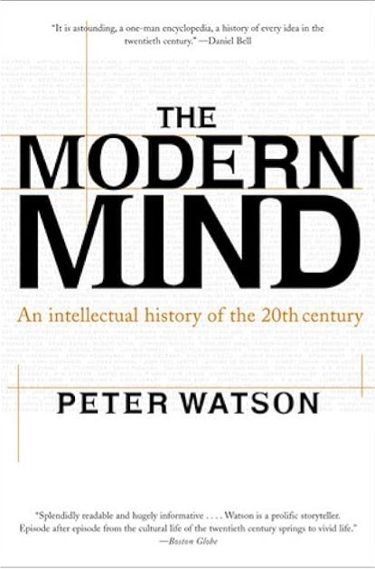
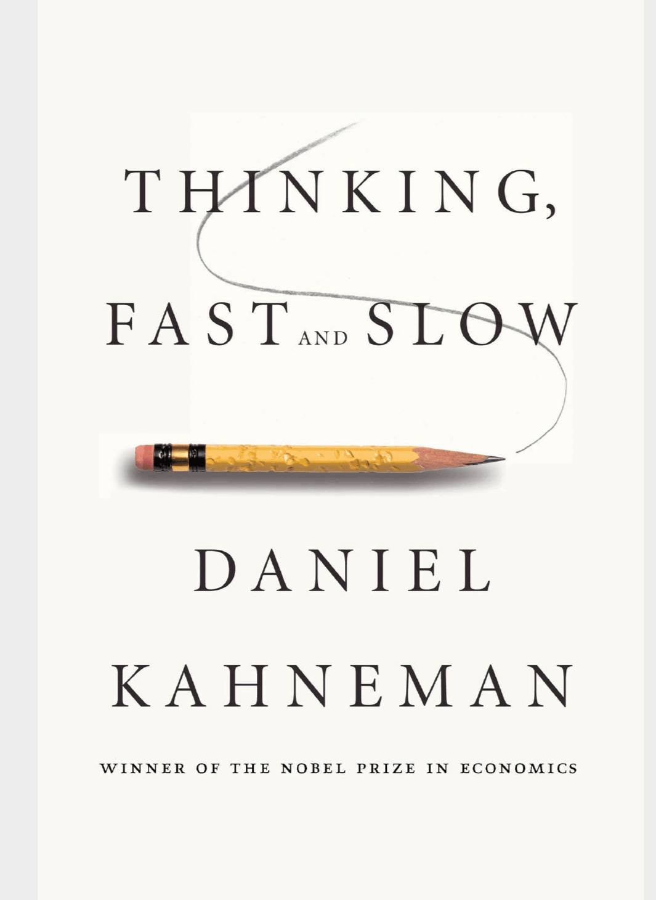
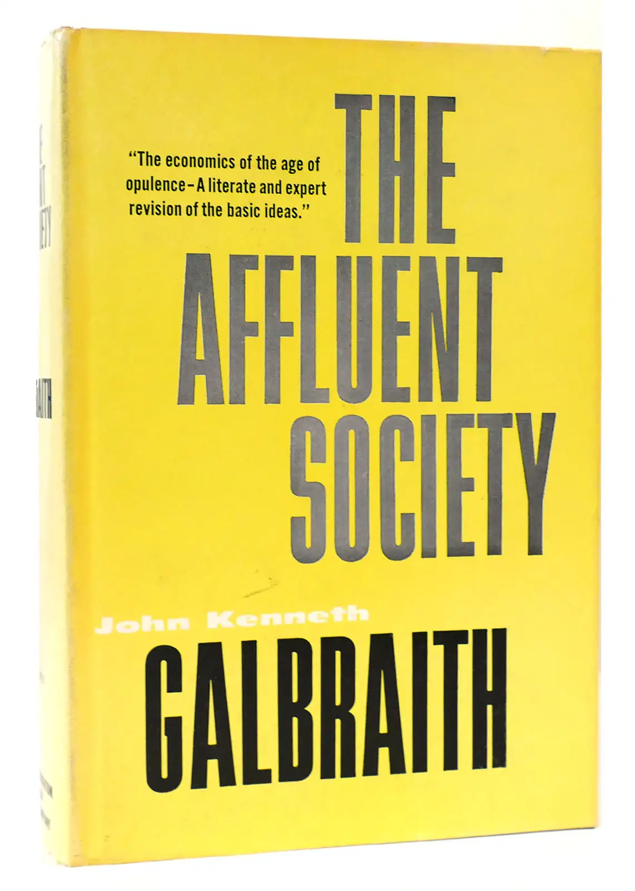
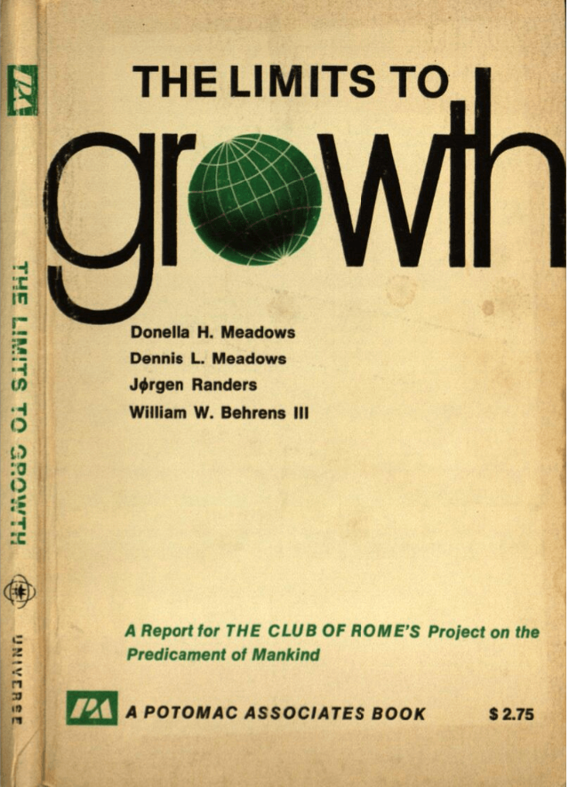

<a href="books_english.md" class="flag-link">🇬🇧</a>

Jeg har alltid vært glad i å lese bøker. Men, det har blitt veldig mange bøker de siste årene. Jeg husker ikke lenger <u>**når**</u> dette startet, men det er iallfall over ti år siden nå. Men, jeg husker <u>**hvordan**</u> det startet. Jeg har jobbet i oljebransjen med modellering av reservoarene som man finner olje og/eller gass i. Hvis du er nysgjerrig om hvilke felter jeg har jobbet med så kan du sjekke ut hvilke jeg har jobbet med <a href="fields.md">her</a>.

Det er mye man ikke kan vite om disse feltene, siden de ligger mange hundre, hvis ikke tusenvis av meter under bakken. For de norske feltene sin del ligger de under havbunnen og deretter under flere tusen meter med stein. Derfor har man rett og slett et ganske uklart bilde om hvordan detaljene er der nede. Derfor lager man digitale modeller som man så bruker for planlegging. Disse modellene inneholder ganske mange antagelser, og mange av de kan være feil. Som modellør står man bak mange av disse antagelsene. For å bli bedre til å gjøre jobben min begynte jeg å lese om hvordan hjernen vår fungerer, og spesielt om temaet kognitiv bias. Enkelt forklart er det måter hjernen vår kan gjøre feil på, ikke fordi du er dum eller noe slikt, men fordi hjernen vår ikke er en datamaskin, men en del av et biologisk vesen.

Den mest kjente boka om dette er kanskje boka til **Daniel Kahneman** som heter _Thinking fast and slow_. Altså å tenke fort og langsomt. Han beskriver hvordan mange av de raske måtene har vært helt sentrale for vår overlevelse, spesielt tidlig i menneskehetens utvikling. Men, det er også en kilde til mange feilslutninger som vi gjør. Du kan ikke unngå å gjøre slike feilslutninger, hjernen er laget sånn. Det eneste du kan gjøre er å gjøre deg bevisst på at sånn er vi alle. Og helst ta i mot input fra andre.. Det fikk meg til å lure på hvilke feilslutninger var det jeg gjorde?

Omtrent samtidig, som sagt jeg husker ikke detaljene, leste jeg boken _The modern mind_ av **Peter Watson**. Den er en fantastisk bok som prøver å beskrive hele den intellektuelle utviklingen fra år 1900 til 2000. Jeg begynte å lese boka fordi en kollega fortalte at den ga en god oversikt over all utviklingen innen realfagene som skjedde. Det var gøy å lese om det, jeg er helt enig, men jeg ble like grepet av hva den beskrev om utviklingen innenfor samfunnsfagene. Jeg leste om sosiologiske teorier om hvordan mennesker relaterer seg til hverandre i _The lonely crowd_ av **David Riesman**, teknologikritikken fra **Horkheimer og Adorno** etter andre verdenskrig i _Dialectic of the Enlightment_, hvordan **J.K Galbraith** mente at det amerikanske samfunnet ikke trengte fokusere like mye på produksjon og teknologisk utvikling lenger allerede på slutten av 50 tallet (i boken _The Affluent Society_) og mye mer.

Jeg leste om den den stille våren (_Silent spring_), som er beskrevet som den første boka om miljøvern av **Rachel Carson**, og _Limits to growth_ av **Donella Medows** og andre, blant annet norske **Jørgen Randers**.
Alt dette har forandret meg, og mitt forhold til verden rett og slett. Etterhvert har jeg lest mange av disse bøkene, og det har også hatt en snøballeffekt.

Nå leser jeg hele tiden, samtidig som ønskelista mi bare blir lengre. Det har blitt mange, mange bøker etterhvert. Fellestrekket er vel at de har alle noe med menneskeheten, og hvordan vi oppfører oss på denne planeten. Hvis du har lyst til å se lista, ligger den under her.

## 📚 Bøker om menneskehetens tilstand

Applebaum, A. (2020). _Twilight of Democracy: The Seductive Lure of Authoritarianism._ Knopf Doubleday Publishing Group.  
Ariely, D. (2009). _Predictably irrational_ HarperCollins UK.  
Ayres, R. U., & Ayres, E. H. (2009). _Crossing the Energy Divide: Moving from Fossil Fuel Dependence to a Clean-Energy Future._ Pearson Prentice Hall.  
Bardhan, P. (2022). _A World of Insecurity: Democratic Disenchantment in Rich and Poor Countries._ Harvard University Press.  
Barnes, P. (2014). _With Liberty and Dividends for All: How to Save Our Middle Class When Jobs Don’t Pay Enough._ Berrett-Koehler Publishers.  
Bjørkdahl, K., & Lykke, K. V. (2023). _Hva vi spiser når vi spiser kjøtt._ Res Publica.  
Bloodworth, J. (2018). _Hired: Six Months Undercover in Low-Wage Britain._ Atlantic Books.  
Brand, U., & Wissen, M. (2021). _The Imperial Mode of Living: Everyday Life and the Ecological Crisis of Capitalism._ Verso Books.  
Brøgger, J. (1993). _Kulturforståelse: En nøkkel til vår internasjonale samtid._ Damm.  
Bullough, O. (2018). _Moneyland: Why Thieves And Crooks Now Rule The World And How To Take It Back._ Profile Books.  
Burnett, D. (2016). _The Idiot Brain: A Neuroscientist Explains What Your Head is Really Up To._ Guardian Faber Publishing.  
Cohen, S. (2001). States of Denial: _Knowing About Atrocities and Suffering._ Polity Press.  
De Oliveira, V. M. (2021). _Hospicing modernity: Facing humanity’s wrongs and the implications for social activism._ North Atlantic Books.  
DiAngelo, R. (2019). _White Fragility: Why It’s So Hard for White People to Talk About Racism._ Penguin UK.  
Dixson-Declève, S., Gaffney, O., Ghosh, J., Randers, J., Rockström, J., & Stoknes, P. E. (2022). _Earth for all: A survival guide for humanity : a report to the Club of Rome (2022) fifty years after The Limits to Growth (1972)._ New Society Publishers.  
Dorling, D. (2020). _Slowdown: The End of the Great Acceleration—and Why It’s Good for the Planet, the Economy, and Our Lives._ Yale University Press.  
Durkheim, É. (1951). _Suicide: A Study in Sociology (G._ Simpson, Red.; J. A. Spaulding & G. Simpson, Overs.). The Free Press.  
Dutt, D., Alves, C., Kesar, S., & Kvangraven, I. H. (2025). _Decolonizing Economics: An Introduction._ Polity Press.  
Fisher, M. (2009). _Capitalist Realism: Is There No Alternative?_ John Hunt Publishing.  
Fisher, R., & Ury, W. (2012). _Getting to Yes: Negotiating an agreement without giving in._ Random House.  
Frankl, V. E. (2017). _Man’s Search for Meaning._ Beacon Press.  
Fukuyama, F. (2006). _The End of History and the Last Man._ Simon and Schuster.  
Fukuyama, F. (2014). _Political Order and Political Decay: From the Industrial Revolution to the Globalisation of Democracy._ Profile Books.  
Fukuyama, F. (2018). _Identity: The Demand for Dignity and the Politics of Resentment._ Farrar, Straus and Giroux.  
Gabrielsen, B. (2020). _Skjermslaver._ Kagge forlag as.  
Garces, M. (2024). _New Radical Enlightenment: Philosophy for a Common World._ Verso Books.  
Giblin, R., & Doctorow, C. (2022). _Chokepoint Capitalism._ Beacon Press.  
Gleeson-White, J. (2015). _Six Capitals, or Can Accountants Save the Planet?: Rethinking Capitalism for the Twenty-First Century._ W. W. Norton & Company.  
Goodhart, D. (2017). _The Road to Somewhere: The Populist Revolt and the Future of Politics._ Oxford University Press.  
Graeber, D. (2012). _Debt: The First 5000 Years._ Penguin Books Limited.  
Gray, J. (2015). _Straw Dogs: Thoughts On Humans And Other Animals._ Granta Books.  
Habermas, J. (1989). _The Structural Transformation of the Public Sphere: An Inquiry Into a Category of Bourgeois Society._ Polity Press.  
Harari, Y. N. (2014). _Sapiens: A Brief History of Humankind: The multi-million copy bestseller._ Random House.  
Hickel, J. (2020). _Less is More: How Degrowth Will Save the World._ Random House.  
Hippe, I. (2021). _Korstoget mot velferdsstaten: På innsiden av nyliberale tenketanker._ Svein Sandnes Bokforlag.  
Horkheimer, M., Adorno, T. W., & Noeri, G. (2002). _Dialectic of Enlightenment._ Stanford University Press.  
Horvath, J. C. (2025). _The Digital Delusion: How To Topple Big Tech And Save Your Brain._ Wiley.  
Hull, R. B., Robertson, D. P., & Mortimer, M. (2020). _Leadership for Sustainability: Strategies for Tackling Wicked Problems._ Island Press.  
Isaksen, T. R. (2023). _Ingen tror på nåtiden: Drømmene fra 1989, hvorfor verden blir mørkere og jakten på lyspunkter._ Kagge Forlag.  
Jackson, T. (2016). _Prosperity without Growth: Foundations for the Economy of Tomorrow._ Taylor & Francis.  
Jackson, T. (2021). _Post Growth: Life after Capitalism._ John Wiley & Sons.  
Jeffries, S. (2022). _Everything, All the Time, Everywhere: How We Became Postmodern._ Verso Books.  
Kahneman, D. (2011). _Thinking, Fast and Slow._ Penguin UK.  
Klein, N. (2019). _On Fire: The Burning Case for a Green New Deal._ Penguin UK.  
Lasch, C. (1991). _The Culture of Narcissism: American Life in an Age of Diminishing Expectations._ W. W. Norton & Company.  
Latour, B. (2018). _Down to Earth: Politics in the New Climatic Regime._ John Wiley & Sons.  
Lindgren, L. (2021). _Ekko: Et essay om algoritmer og begjær._ Gyldendal.  
Lykkeberg, R. (2019). _Vesten mod Vesten: Fortællinger om det politiske opbrud fra efterkrigstiden til Brexit og Trump (1._ utg.). Informations Forlag.  
Marsdal, M. E. (2021). _Parterapi: For oljefolk og klimaaktivister._ Manifest forlag.  
Mbembe, A. (2020). _Necropolitics._ Duke University Press.  
Mbembe, A. (2022). _The Earthly Community: Reflections on the Last Utopia._ V2*Publishing.  
McDonough, W., & Braungart, M. (2013). \_The Upcycle: Beyond Sustainability--Designing for Abundance.* Farrar, Straus and Giroux.  
McGuire, B. (2022). _Hothouse Earth: An Inhabitant’s Guide._ Icon Books.  
Meadows, D. (2008). _Thinking in Systems: International Bestseller._ Chelsea Green Publishing.  
Meadows, D., Randers, J., & Meadows, D. (2004). _Limits to Growth: The 30-Year Update._ Chelsea Green Publishing.  
Merchant, B. (2023). _Blood in the Machine: The Origins of the Rebellion Against Big Tech._ Hachette UK.  
Michaels, F. S. (2011). _Monoculture: How One Story Is Changing Everything._ Red Clover Press.  
Milanovic, B. (2023). _Visions of Inequality: From the French Revolution to the End of the Cold War._ Harvard University Press.  
Mildenberger, M. (2020). _Carbon Captured: How Business and Labor Control Climate Politics._ MIT Press.  
Mishra, P. (2019). _Raseriets tidsalder._ Solum forlag as.  
Mjaaland, M. T., Eriksen, T. H., & Hessen, D. O. (2024). _Antropocen: Menneskets tidsalder._ Res Publica.  
Monbiot, G. (2004). _The Age of Consent: A Manifesto for a New World Order._ Harper Perennial.  
Monbiot, G. (2013). _Feral: Searching for Enchantment on the Frontiers of Rewilding._ Penguin UK.  
Moyn, S. (2023). _Liberalism Against Itself: Cold War Intellectuals and the Making of Our Times._ Yale University Press.  
Nair, C. (2022). _Dismantling Global White Privilege: Equity for a Post-Western World._ Berrett-Koehler Publishers.  
Nørmark, D., & Jensen, A. F. (2018). _Pseudoarbejde: Hvordan vi fik travlt med at lave ingenting (1._ utg.). Gyldendal Business.  
Piketty, T. (2015). _The Economics of Inequality._ Harvard University Press.  
Piketty, T. (2020). _Capital and Ideology._ Harvard University Press.  
Polman, P., & Winston, A. (2021). _Net Positive: How Courageous Companies Thrive by Giving More Than They Take._ Harvard Business Press.  
Postman, N. (1992). _Technopoly: The Surrender of Culture to Technology._ Knopf.  
Rathi, A. (2024). _Climate Capitalism: Winning the Race to Zero Emissions and Solving the Crisis of Our Age._ Greystone Books Ltd.  
Raworth, K. (2018). _Doughnut Economics: Seven Ways to Think Like a 21st Century Economist._ Chelsea Green Publishing.  
Read, R., & Alexander, S. (2019). _This Civilisation is Finished: Conversations on the end of Empire - and what lies beyond._ Simplicity Institute.  
Reinertsen, M. B. (2017). _Reisen til Bretton Woods._ Cappelen Damm.  
Riesman, D., Glazer, N., & Denney, R. (2020). _The Lonely Crowd: A Study of the Changing American Character._ Yale University Press.  
Riise, A. B. (2021). _Mitt klimaregnskap._ Res Publica.  
Robinson, K. S. (2020). _The Ministry for the Future._ Hachette UK.  
Rogan, T. (2019). _The Moral Economists: R. H. Tawney, Karl Polanyi, E. P. Thompson, and the Critique of Capitalism._ Princeton University Press.  
Rosa, H. (2019). _Resonance: A Sociology of Our Relationship to the World._ John Wiley & Sons.  
Rosling, H., Rönnlund, A. R., & Rosling, O. (2018). _Factfulness: Ten Reasons We’re Wrong About the World--and Why Things Are Better Than You Think._ Flatiron Books.  
Rushkoff, D. (2022). _Survival of the Richest: Escape Fantasies of the Tech Billionaires._ W. W. Norton & Company.  
Russell, B. (2008). _History of Western Philosophy._ Simon and Schuster.  
Russell, B. (2022). _The Problems of Philosophy._ DigiCat.  
Røyne, A. (2020). _Varm klode._ Kaldt hode. Kagge forlag as.  
Röstlund, L. (2025). _Norgeparadoxen: En granskning av det goda landets svarta baksida._ Bokförlaget Forum.  
Said, E. W. (1995). _Orientalism._ Penguin Books India.  
Slobodian, Q. (2023). _Crack-Up Capitalism: Market Radicals and the Dream of a World Without Democracy._ Random House.  
Snyder, T. (2017). _On Tyranny: Twenty Lessons from the Twentieth Century._ Crown.  
Svendsen, L. Fr. H. (1999). _Kjedsomhetens filosofi._ Universitetsforlaget.  
Svendsen, L. Fr. H. (2001). _Ondskapens filosofi._ Universitetsforlaget.  
Stalsberg, L. (2021). _Etter pandemien: Tanker om krise, kapitalisme og en ny hverdag (1._ utg.). Manifest forlag.  
Stalsberg, L. (2022). _Det er nok nå: Hvordan nyliberalismen ødelegger mennesker og natur._ Forlaget Manifest AS.  
Stoknes, P. E. (2020). _Grønn vekst: En sunn økonomi for det 21._ århundre. Tiden norsk forlag.  
Stoknes, P. E. (med Jostein Sand Nilsen, & Stoknes, P. E.). (2017). _Det vi tenker på når vi prøver å ikke tenke på global oppvarming._ Tiden.  
Tainter, J. A., & Patzek, T. W. (2011). _Drilling Down: The Gulf Oil Debacle and Our Energy Dilemma._ Springer Science & Business Media. https://doi.org/10.1007/978-1-4419-7677-2  
Taleb, N. N. (2008). _The Black Swan: The Impact of the Highly Improbable._ Penguin UK.  
Tetlock, P. E. (2017). _Expert Political Judgment: How Good Is It? How Can We Know? - New Edition._ Princeton University Press.  
Tetlock, P., & Gardner, D. (2015). _Superforecasting: The Art and Science of Prediction._ Random House.  
Thaler, R. H., & Sunstein, C. R. (2021). _Nudge: The Final Edition._ Yale University Press.  
Thompson, H. (2022). _Disorder: Hard Times in the 21st Century._ Oxford University Press.  
Vetlesen, A. J., & Henriksen, J.-O. (2022). _Etikk i klimakrisens tid._ Res Publica.  
Watson, P. (2023). _The Modern Mind: An Intellectual History of the 20th Century._ Harper Collins.  
Weber, M. (2011). _The Protestant Ethic and the Spirit of Capitalism (S._ Kalberg, Red.). Oxford University Press.  
Whyte, W. H. (2013). _The Organization Man._ University of Pennsylvania Press.  
Williams, J. (2021). _Climate Change Is Racist: Race, Privilege and the Struggle for Climate Justice._ Icon Books.  
Zuboff, S. (2019). _The Age of Surveillance Capitalism: The Fight for a Human Future at the New Frontier of Power._ Hachette UK.

<a href="index.md" class="boom-link">🪃</a>
