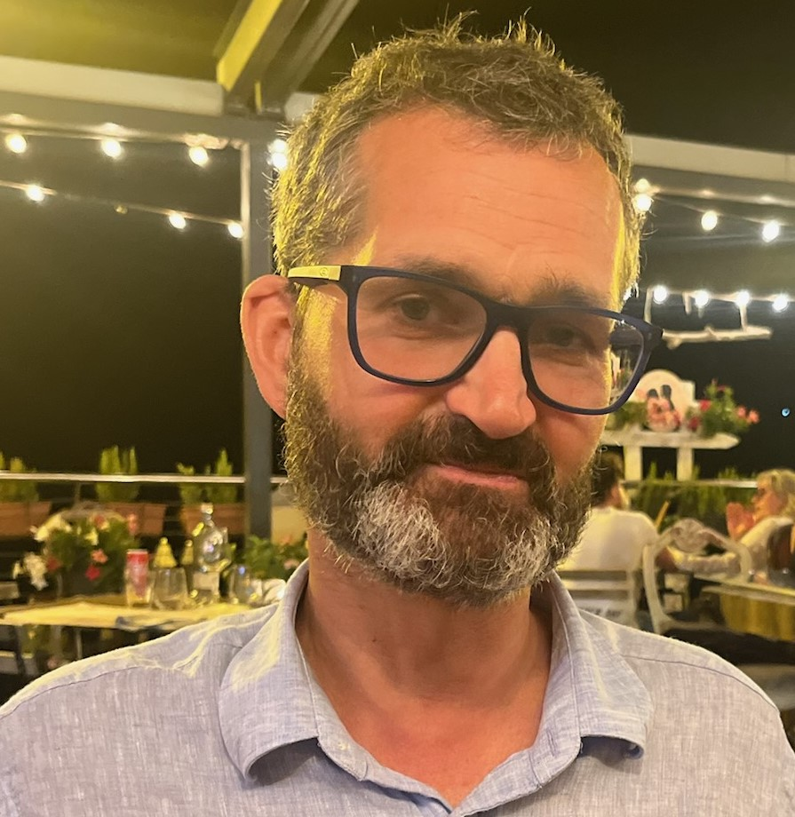

<a href="index_english.md" class="flag-link">🇬🇧</a>

Velkommen til denne nettsiden! Håper du finner den interessant. Jeg har laget denne mest for å fortelle om den reisen jeg har hatt de siste årene. Jeg vet det er en del mennesker som har de samme tankene som meg, og ønsker å dele min historie. Kanskje du blir nysgjerrig på disse tankene? Eller, hvis du deler mitt syn allerede, blir inspirert til å dele dine egne tanker med andre?

Under er et bilde av meg, **Daniel Berge Sollien**, jeg har jobbet hele min yrkeskarriere i oljebransjen, men har nå sluttet av samvittighetsårsaker. Beveger du deg rundt på disse sidene vil du finne en del om den reisen jeg har hatt. Men, først litt om hvem jeg er:

<figure>

<figcaption>Dette er meg.</figcaption>
</figure>

Jeg er en person med mange interesser. Jeg er veldig glad i utendørsaktiviteter, spesielt når jeg kan være ute i naturen, lidenskaplig interessert i musikk, bekymrer meg for verden, elsker kona og ungene høyt, har en virkelig rar nerdete glede av å programmere, og mye mer. Det jeg er mest opptatt av for tiden, er det noen kaller metakrisen, andre omtaler som menneskehetens utfordringer. Jeg har fordypet meg i dette temaet i over ti år nå, og jeg klarer ikke å stoppe, for det er stadig mer å lære. Jeg lærer mer om situasjonen ved å lese bøker, lytte til podcaster, og ved å diskutere det med andre. Det har ført til at jeg har satt meg inn i temaer innen filosofi, psykologi, sosiologi, alternative økonomiske teorier, og klimavitenskap.

Etter at jeg forlot oljebransjen tenkte jeg at jeg skulle bidra til det grønne skiftet, men jeg fikk ikke et eneste intervju. Jeg må innrømme at jeg forventet at jeg skulle være interessant for den bransjen, med min bakgrunn fra oljebransjen med mye erfaring med analyser av store data, avansert modellering, og digitale ferdigheter. Den gang ei, selv ikke etter at jeg tok kurs i grønn omstilling ved BI. Om det var feil tid, eller bare noe med meg vil jeg aldri få vite.

Dermed tok jeg praktisk pedagogisk utdanning (PPU) for å bli lærer, nærmest som en nødløsning. Men, i løpet av året 2025-2026 har jeg begynt å tenke at dette er det beste jeg kan gjøre resten av min yrkeskarriere. Å bidra til neste generasjon sin reise.

> _I dag vet vi mer om forholdet mellom kunnskap og makt, enn om forholdet mellom kunnskap og frigjøring_ 
>
> <cite>**Marina Garcés**</cite>

De siste årene jeg engasjert meg for den endringen som jeg mener verden trenger, blant annet deltatt i den offentlige debatten, for jeg mener vi er på vei i feil retning, egentlig på mange plan. Er du nysgjerrig på hvordan jeg har engasjert meg så kan du ta en titt på <a href="engasjement.md">denne siden</a>.

I juni 2026 ble jeg medlem i nettverket [Life After Oil](https://lifeafteroil.net/). Dette nettverket har som mål å hjelpe folk som jobber i olje og gass som har bekymringer for retningen til industrien, og som enten ønsker å høre mer fra andre som har forlatt den, eller vurderer å slutte selv. Nettverket oppsto i Storbritannia, men vi har nå en aktiv norsk gren av nettverket, hvor jeg er aktiv.

Et av målene med denne nettsiden er å dele noen av de <a href="folk.md">personene</a>, <a href="bøker.md">bøkene</a> og <a href="podcasts.md">podcastene</a> som har inspirert meg. Ta en titt.

Hvis du har lyst til å vite mer om bakgrunnen min, så kan du ta en titt på <a href="cv.md">cv'en min</a>.
